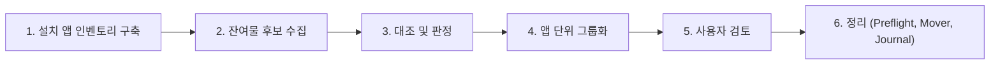
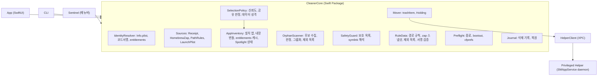

# macOS App Cleaner 개발 계획서 (v4)

> 개정 이력
> - v1: 초안
> - v2: 리뷰 반영 — 권한 모델/Spotlight 역할 정정, 삭제 전 정리 절차·정보원(pkgutil, Homebrew zap, entitlements)·누락 경로 추가, 신뢰도 점수, 배포 제약, 테스트 전략, MVP/로드맵 재구성
> - v3: 고아 잔여물 정리를 **독립 메뉴/독립 실행 기능**으로 분리하고 MVP에 포함 (4.5절, 7장 재작성)
> - v4: 리뷰 반영 — 공유 리소스 판정을 앱 제거 흐름에도 적용(4.3.2), 데이터 성격 분류 축 추가(4.3.3), iCloud 컨테이너 보호, Homebrew zap 강등, Pre-flight 순서 정정(bootout → 종료), SMAppService 내장 plist 탐지, 권한 헬퍼 TOCTOU 대응(5.3), 고아 스캔 기본 선택 축소·Spotlight 상태 검사, 복원 메타데이터 보존, 규칙 데이터 서명, macOS 15 Group Container 보호, 일정 재조정

---

## 1. 개요

### 1.1 문제 정의
macOS에서 `.app`을 휴지통으로 옮기는 것만으로는 앱이 생성한 설정, 캐시, 샌드박스 컨테이너, 백그라운드 서비스(LaunchAgent/Daemon), 권한 헬퍼 등이 남는다. 이는 디스크를 낭비하고, 경우에 따라 앱이 없는데도 백그라운드 프로세스가 계속 실행된다.

### 1.2 목표 (Goals)
- 앱 1개를 지정하면 관련 잔여물을 **정확하게** 찾아 **복구 가능한 방식으로** 제거한다.
- 이미 삭제된 앱(실행 파일만 지운 경우)의 잔여물(고아 파일)을 **앱 지정 없이 독립적으로** 찾아 정리한다.
- 오삭제를 구조적으로 방지한다 (신뢰도 점수, 공유 리소스 판정, 사용자 데이터 분류, 보호 목록, dry-run, 복원).

### 1.3 비목표 (Non-goals)
- 시스템 전반 정리(브라우저 캐시, 대용량 파일 탐색 등) — 범위 외. 단 패키지 매니저(npm·cargo·pipx·uv)로 설치한 CLI 도구와 그 데이터·다운로드 캐시는 [packages.md](packages.md)에서 다룬다 (#39).
- Mac App Store 배포 (6.3절 참조 — 구조적으로 불가).
- 커널 확장(kext)·System Extension의 자동 제거 (탐지 및 안내만 수행).
- 키체인 항목 탐지·삭제 (안내만 수행 — 3.3절).
- Apple 앱(`com.apple.*`) 제거 — GarageBand·iMovie·Xcode 등 `/Applications`의 Apple 앱도 v1 범위에서 제외 (5.1절).

### 1.4 참고 프로젝트
- **AppCleaner (FreeMacSoft)**: 폐쇄형 프리웨어. UX 참고.
- **Pearcleaner**: Swift/SwiftUI 기반, 소스 공개. 단 **fair-code 계열 라이선스(Commons Clause 등)이므로 코드 재사용 금지**, 동작·기능 아이디어만 참고. (착수 전 최신 LICENSE 재확인)
- **Homebrew Cask `zap` stanza**: 앱별 잔여물 경로를 사람이 정리해 둔 데이터(BSD-2-Clause, 번들 시 고지 포함). 규칙 DB로 활용하되 **공유 경로를 포함할 수 있으므로** 보조 근거로만 사용 (4.2절).

---

## 2. 기존 셸 스크립트 분석

### 2.1 스크립트 자체의 버그 (알려진 함정으로 기록)

| # | 코드 | 문제 |
|---|---|---|
| 1 | `RED='\033[0m'` | 빨간색이 아니라 **리셋 코드**. 올바른 값은 `'\033[0;31m'` |
| 2 | 내부 `for f in $expanded_path; do ... fi` | `done` 대신 `fi`로 닫혀 **문법 오류 — 스크립트가 실행되지 않음** |
| 3 | `eval "expanded_path=\"$path\""` | 사용자 입력이 `eval`에 그대로 들어가 **명령 주입** 가능 (예: 앱 이름에 `$(…)`) |
| 4 | `"$HOME/Library/Caches/com.todesktop."*` | Cursor 전용 의도이나 **ToDesktop 기반의 모든 앱 캐시**를 삭제 |
| 5 | `*${APP_LOWER}*` 와일드카드 | `code`, `mail`, `go` 같은 이름 입력 시 **무관한 앱의 설정까지 매칭** |
| 6 | `for f in $expanded_path` (따옴표 없음) | 공백 포함 경로(`Application Support`)가 단어 분리되어 오동작 |
| 7 | `rm -rf` | 복구 불가능한 영구 삭제 |

### 2.2 스크립트에서 계승할 점
- 앱 이름 기반 탐색 대상 중 `~/.<app>` 같은 **홈 디렉토리 dotfile** 경로 (v1에서 누락되었던 항목).
- "검색 → 목록 표시 → 사용자 확인 → 삭제"의 2단계 흐름.

### 2.3 개선 방향 요약

| 항목 | 스크립트 | 본 앱 |
|---|---|---|
| 식별 | 이름 문자열 와일드카드 | 번들 ID + Team ID + App Group + 설치 영수증 + 이름(보조) |
| 매칭 판단 | 일치/불일치 | **신뢰도 점수(High/Medium/Low)** + **공유 여부** + **데이터 성격**, Low·공유·사용자 데이터는 기본 미선택 |
| 삭제 방식 | `rm -rf` | 휴지통 이동 / 보류 폴더 이동 + **삭제 기록 및 복원** |
| 백그라운드 서비스 | 미처리 | `launchctl bootout` 후 제거, 로그인 항목 안내 |
| 실행 중인 앱 | 미처리 | 서비스 중지 → 번들 내 모든 프로세스 종료 후 진행 |
| 권한 | 실패 시 에러 | Full Disk Access / App Management / 관리자 헬퍼 |

---

## 3. 잔여물 탐색 대상 경로

표기: `<BID>` = `CFBundleIdentifier`, `<NAME>` = `CFBundleName`/표시 이름, `<TEAM>` = 서명 Team ID, `<GROUP>` = App Group ID.
`<BID>*`는 `<BID>` 자체 또는 `<BID>.`로 시작하는 항목(헬퍼, ShipIt 등)을 의미한다 — **점(.) 경계 없이 접두사만으로 매칭하지 않는다.**

### 3.1 사용자 도메인 (`~`)

| 카테고리 | 경로 | 비고 |
|---|---|---|
| 앱 본체 | `~/Applications/<NAME>.app` | |
| Sandbox Container | `~/Library/Containers/<BID>*` | 용량 최대. macOS 14+ 접근 시 확인창 (5.2절). **사용자 문서·DB가 들어 있을 수 있음** → 하위 항목을 데이터 성격별로 분류 (4.3.3절) |
| Group Container | `~/Library/Group Containers/<GROUP>` | `<TEAM>.xxx` 또는 `group.xxx` 형태. entitlements로 정확히 식별. **같은 벤더의 여러 앱이 공유하는 경우가 많음** (예: `UBF8T346G9.Office`) → 4.3.2절 공유 판정 필수. macOS 15+ 접근 보호 |
| iCloud 앱 컨테이너 | `~/Library/Mobile Documents/iCloud~<BID의 .을 ~로>` | **탐지·안내만, 절대 이동하지 않음** — 삭제가 iCloud로 동기화되어 다른 기기에서도 사라짐 (5.1절) |
| Application Support | `~/Library/Application Support/<BID>*`, `…/<NAME>` | Electron 앱은 대부분 `<NAME>` |
| Application Scripts | `~/Library/Application Scripts/<BID>*`, `…/<GROUP>` | |
| Caches | `~/Library/Caches/<BID>*`, `…/<NAME>` | Squirrel 업데이터 `<BID>.ShipIt` 포함 |
| HTTP/Web 데이터 | `~/Library/HTTPStorages/<BID>*`, `~/Library/WebKit/<BID>*` | |
| Cookies | `~/Library/Cookies/<BID>.binarycookies` | |
| Preferences | `~/Library/Preferences/<BID>*.plist` | 삭제 전 cfprefsd 처리 필요 (4.4절) |
| Preferences (ByHost) | `~/Library/Preferences/ByHost/<BID>.*.plist` | v1 누락 |
| Saved State | `~/Library/Saved Application State/<BID>.savedState` | |
| Logs | `~/Library/Logs/<NAME>`, `…/<BID>*` | |
| 진단 리포트 | `~/Library/Logs/DiagnosticReports/<NAME>[-_]*` | 이름 패턴 기반 → Low (4.3절) |
| LaunchAgents | `~/Library/LaunchAgents/<BID>*.plist` | 파일명뿐 아니라 **plist 내부 `Program`/`ProgramArguments`가 앱 경로를 가리키는지**로도 판정. 벤더 공용 업데이터(Google Keystone, Microsoft AutoUpdate 등)는 4.3.2절 공유 판정 |
| 플러그인류 | `~/Library/Internet Plug-Ins`, `~/Library/QuickLook`, `~/Library/Services`, `~/Library/PreferencePanes`, `~/Library/Spotlight` | 번들 내부 Info.plist의 BID로 판정 |
| 사용자 임시 폴더 | `$(getconf DARWIN_USER_CACHE_DIR)<BID>*`, `$(getconf DARWIN_USER_TEMP_DIR)<BID>*` | `/var/folders/xx/…/C/`, `…/T/`의 정확한 경로를 API로 구함 |
| Dotfiles | `~/.<name>`, `~/.config/<name>`, `~/.local/share/<name>`, `~/.cache/<name>`, `~/.local/state/<name>` (+ `XDG_*_HOME`으로 바꾼 홈 안 위치) | 이름 기반 → 기본 Low. CLI·Electron 앱에서 중요 (v1 누락) |

### 3.2 시스템 도메인 (`/`, 관리자 권한 필요)

| 카테고리 | 경로 | 비고 |
|---|---|---|
| 앱 본체 | `/Applications/<NAME>.app` | macOS 13+ App Management 권한 필요 (5.2절) |
| Application Support | `/Library/Application Support/<BID>*`, `…/<NAME>` | |
| Caches | `/Library/Caches/<BID>*` | |
| Preferences | `/Library/Preferences/<BID>*.plist` | |
| Logs | `/Library/Logs/<NAME>`, `/Library/Logs/DiagnosticReports/<NAME>[-_]*` | |
| LaunchAgents | `/Library/LaunchAgents/<BID>*.plist` | 모든 사용자에게 적용됨 |
| 번들 내장 Launch plist | `<앱>/Contents/Library/LaunchAgents/*.plist`, `…/LaunchDaemons/*.plist` | `SMAppService`(macOS 13+)로 등록된 서비스. 파일은 번들과 함께 사라지지만 **launchd 등록은 남으므로** Label을 수집해 bootout 대상에 포함 |
| LaunchDaemons | `/Library/LaunchDaemons/<BID>*.plist` | root로 실행 중일 수 있음 |
| Privileged Helper | `/Library/PrivilegedHelperTools/<BID>*` | 대응 LaunchDaemon과 쌍으로 처리 |
| 설치 영수증 | `/private/var/db/receipts/<pkg-id>.{bom,plist}` | `pkgutil --forget`으로 제거 (4.2절) |
| 커널 확장 | `/Library/Extensions/*.kext` | **탐지·안내만** |
| System Extension | `systemextensionsctl list` 결과 | **탐지·안내만** — 제거는 소유 앱이 비활성화해야 하며, CLI 제거는 SIP 해제 필요 |

### 3.3 파일이 아닌 시스템 데이터

| 항목 | 처리 방식 |
|---|---|
| 로그인 항목 / 백그라운드 항목 (BTM, macOS 13+) | 앱 번들이 사라지면 대부분 무효화됨. 남아 있으면 *시스템 설정 > 일반 > 로그인 항목*으로 안내. `sfltool resetbtm`은 **전체 초기화이므로 사용 금지** |
| 개인정보 보호 권한 기록 (TCC) | 선택 옵션: `tccutil reset All <BID>` |
| 키체인 항목 | **안내만** — data protection keychain 항목은 다른 앱이 열거할 수 없어 탐지가 불완전하다. 완료 화면에서 *키체인 접근* 앱에서 앱 이름으로 검색하도록 안내 (자동 삭제 안 함) |

---

## 4. 탐지 엔진 설계

### 4.1 식별 정보 수집 (Identity)
대상 `.app`에서 다음을 추출해 `AppIdentity`를 구성한다.

| 정보 | 출처 |
|---|---|
| `CFBundleIdentifier`, `CFBundleName`, `CFBundleDisplayName`, `CFBundleExecutable` | `Contents/Info.plist` |
| Team ID | Security.framework `SecStaticCodeCreateWithPath` → `SecCodeCopySigningInformation` → `kSecCodeInfoTeamIdentifier` |
| App Group ID 목록 | 위 API의 `kSecCodeInfoEntitlementsDict` → `com.apple.security.application-groups` (CLI 대응: `codesign -d --entitlements - --xml <app>`) |
| 내장 헬퍼/확장 BID | `Contents/Library/LoginItems`, `Contents/Library/LaunchServices`, `Contents/PlugIns`, `Contents/Library/SystemExtensions`, `Contents/Helpers`, `Contents/Frameworks/*.app` 하위 번들의 Info.plist |
| 내장 Launch 서비스 Label | `Contents/Library/LaunchAgents/*.plist`, `Contents/Library/LaunchDaemons/*.plist`의 `Label` (`SMAppService` 등록분, `BundleProgram` 사용) |
| iOS/iPadOS 앱 (Apple Silicon) | `Wrapper/*.app/Info.plist` (`WrappedBundle`) — 외부 번들의 Info.plist와 BID가 다를 수 있음 |
| 설치 패키지 ID | `pkgutil --file-info <app경로>` 또는 `pkgutil --pkgs` 순회 |

### 4.2 정보원 (Sources) — 정확도 순

1. **설치 영수증 (`pkgutil`)** — `.pkg`로 설치된 앱의 *실제 설치 파일 목록*.
   - `pkgutil --pkg-info <id>`로 설치 위치(`volume`, `location`) 확인 → `pkgutil --files <id>`의 상대 경로와 결합.
   - 공유 디렉토리(`/Library/Application Support` 자체 등)는 제외하고 **해당 패키지만 소유한 파일/폴더**만 후보로 등록.
   - 정리 후 `pkgutil --forget <id>` (root).
2. **Homebrew Cask `zap` 규칙** — 앱 BID 또는 이름으로 cask를 매칭해 `zap trash:`/`delete:` 경로를 후보에 추가.
   - zap은 Homebrew 문서상 **다른 앱과 공유하는 파일까지 지울 수 있는** 규칙이므로 **최대 Medium**으로 등록하고, 4.3.2절 공유 판정을 반드시 거친다. 다른 정보원(BID 일치 등)이 같은 경로를 독립적으로 찾은 경우에만 그 정보원의 등급을 따른다.
   - 데이터: `https://formulae.brew.sh/api/cask.json` (오프라인용 스냅샷을 앱에 번들, 주기적 갱신 — 갱신 데이터는 서명 검증, 4.6절).
   - Homebrew로 설치된 앱이면 `brew uninstall --zap --cask <token>` 사용을 안내 옵션으로 제공.
3. **경로 규칙 스캔** — 3장의 경로 테이블에 `AppIdentity`를 적용해 후보 탐색.
4. **LaunchAgent/Daemon 내용 분석** — `/Library/Launch*`, `~/Library/LaunchAgents`의 모든 plist와 `launchctl print`로 확인한 등록 서비스를 읽어 `Program`/`ProgramArguments`/`BundleProgram`이 대상 앱 번들 또는 헬퍼를 가리키면 후보 등록 (파일명이 BID와 다른 경우 대응).
   - `ProgramArguments[0]`이 셸·인터프리터(`/bin/sh -c`, `/bin/bash`, `/usr/bin/python3`, `/usr/bin/open` 등)이면 **이후 인자에서 실제 대상 경로를 추출**한다. 추출 실패 시 Low.

> **Spotlight의 역할 (v1 정정)**
> `~/Library` 대부분은 Spotlight 색인 대상이 아니며, `kMDItemCFBundleIdentifier` 질의는 잔여물이 아닌 **앱 번들 자체**만 찾는다. 따라서 잔여물 탐색에는 사용하지 않는다.
> 대신 **동일 BID를 가진 다른 앱 사본 탐지**(예: `~/Downloads`의 다른 버전)에 사용한다 — 사본이 존재하면 공유 데이터(Containers 등) 삭제 전에 경고한다.
> ```
> mdfind "kMDItemCFBundleIdentifier == '<BID>'"
> ```

### 4.3 선택 판정 (신뢰도 · 공유 · 데이터 성격)

최종 선택 여부는 세 축으로 결정한다: **신뢰도**(4.3.1) × **공유 여부**(4.3.2) × **데이터 성격**(4.3.3). 셋 중 하나라도 미선택 조건이면 기본 미선택.

#### 4.3.1 신뢰도

| 등급 | 조건 | 기본 선택 |
|---|---|---|
| **High** | 영수증 소유 파일 / BID·GROUP 정확 일치 또는 `<BID>.` 접두사 / Launch plist가 앱 경로를 가리킴 | ✅ 선택 |
| **Medium** | `<NAME>` 대소문자 무시 **정확 일치** (부분 일치 아님), 이름이 충분히 고유한 경우 / Homebrew zap 규칙 (와일드카드 경로는 Low) | ✅ 선택 (사용자 표시 강조) |
| **Low** | 이름 기반 dotfile, 진단 리포트 패턴, 벤더 공용 폴더(예: `Application Support/Google`), 짧거나 흔한 이름 | ⬜ 미선택 |

이름 매칭 제한 규칙:
- 이름이 4자 미만이거나 흔한 단어 목록(`app`, `code`, `mail`, `notes`, `music`, `go` …)에 있으면 이름 매칭을 **Low로 강등**.
- 부분 문자열(`*name*`) 매칭은 하지 않는다.

#### 4.3.2 공유 리소스 판정 (앱 제거 흐름에도 적용)
BID·GROUP이 정확히 일치해도 **다른 설치 앱이 함께 쓰는 리소스**일 수 있다. 앱 제거 시에도 4.5.2절의 `AppInventory`(캐시 사용)를 조회해 다음을 판정한다.

| 조건 | 처리 |
|---|---|
| Group Container: 인벤토리의 다른 앱(내장 번들 포함) entitlements에 같은 `<GROUP>`이 있음 | **공유** — 미선택 + "Word, Excel이 사용 중" 식으로 사용 앱 표시 |
| Launch plist: 실행 파일이 대상 앱 번들 **밖**에 있고(예: `~/Library/Google/GoogleSoftwareUpdate/…`), 같은 Team ID의 다른 앱이 설치돼 있음 | **공유** — 미선택 (벤더 공용 업데이터) |
| 벤더 공용 폴더(`Application Support/<Vendor>`) 또는 `<TEAM>.` 접두 항목: 같은 Team ID의 다른 앱이 설치돼 있음 | **공유** — 미선택 + 경고 |
| 영수증: 같은 파일을 다른 패키지 영수증도 소유 | 후보에서 제외 |
| 위 조건 해당 없음 | 단독 소유 — 신뢰도 등급대로 |

같은 Team ID의 앱을 마지막으로 제거하는 경우에만 벤더 공용 리소스를 Medium으로 제시한다.

#### 4.3.3 데이터 성격 분류
신뢰도가 High여도 **사용자가 만든 데이터**는 앱과 함께 지우길 원하지 않을 수 있다. 후보(및 컨테이너 하위 항목)를 다음으로 분류해 UI에 함께 표시한다.

| 성격 | 예 | 기본 선택 |
|---|---|---|
| 재생성 가능 | Caches, HTTPStorages, WebKit, Saved State, Logs, 진단 리포트, `/var/folders` | ✅ |
| 설정 | Preferences, ByHost, Cookies, Launch plist, Application Scripts | ✅ |
| 사용자 데이터 | Containers의 `Data/Documents`·`Data/Library/Application Support` 중 비어 있지 않은 것, Group Container 내 DB(`*.sqlite`, `*.realm` 등), `Application Support/<NAME>` 중 대용량(기본 100 MB 이상) 또는 문서 확장자 포함 | ⬜ 미선택 + "사용자 데이터 포함" 경고 |
| 동기화 데이터 | `~/Library/Mobile Documents/iCloud~*` | 🚫 선택 불가 (안내만) |

Container는 폴더 하나로 다루지 않고 위 기준으로 하위 항목을 펼쳐 보여주며, "데이터까지 모두 삭제" 토글로 일괄 선택할 수 있다.

### 4.4 삭제 전 정리 절차 (Pre-flight)

순서대로 수행하며, 각 단계 결과를 삭제 기록에 남긴다.

1. **백그라운드 서비스 중지** — 앱보다 **먼저** 수행한다. `KeepAlive`·`RunAtLoad` 에이전트가 남아 있으면 앱이나 헬퍼를 종료해도 launchd가 즉시 다시 띄운다.
   - 대상: 4.2절 4번으로 찾은 plist의 Label + 4.1절 번들 내장 Launch plist(`SMAppService`)의 Label.
   - 사용자 에이전트: `launchctl bootout gui/<uid>/<label>`
   - 시스템 에이전트/데몬: `launchctl bootout system/<label>` (관리자 권한, 5.3절)
   - plist는 중지 **후에** 이동한다 (먼저 지우면 메모리에 남은 서비스가 계속 실행됨).
2. **실행 중 프로세스 종료**
   - GUI 앱: `NSRunningApplication.runningApplications(withBundleIdentifier:)`로 본체·헬퍼 BID 확인 → `terminate()` 요청.
   - 비-앱 프로세스: `NSRunningApplication`은 LaunchServices에 등록되지 않은 헬퍼·CLI 프로세스를 찾지 못하므로, `proc_listpids` + `proc_pidpath`로 **실행 파일 경로가 대상 번들 내부인 모든 프로세스**를 찾아 `SIGTERM`.
   - 시간 초과 시 사용자에게 강제 종료(`forceTerminate()`/`SIGKILL`) 여부 확인.
3. **환경설정 캐시 무효화** — plist를 그냥 지우면 `cfprefsd`가 메모리 캐시를 다시 써서 파일이 되살아날 수 있다. `CFPreferences`(또는 `defaults delete <BID>`)로 도메인을 지운 뒤 plist 파일을 이동한다. 복원을 위해 지우기 전 plist 사본을 기록에 보관한다.
4. **다른 사본 확인** — 4.2절 Spotlight 질의로 동일 BID 사본이 있으면 경고.
5. **선택 항목 이동** — 이동 직전에 SafetyGuard 재검사(보호 목록·심볼릭 링크·공유 판정) 후 6.1절 정책에 따라 휴지통/보류 폴더로 이동.
6. **후처리** — `pkgutil --forget`, (선택) `tccutil reset All <BID>`, 로그인 항목·키체인·System Extension 안내.

### 4.5 고아 잔여물 탐색 (Orphan Scan) — 독립 실행 기능

앱 제거 흐름과 **별개로** 실행되는 기능이다. 사용자가 과거에 `.app`만 휴지통에 버려 잔여물만 남은 경우를 대상으로 하며, 특정 앱을 지정하지 않고 시스템 전체를 스캔한다.
앱 본체가 없으므로 4.1절의 식별 정보를 쓸 수 없고, **"설치된 앱 목록"과 "잔여물 목록"을 대조**하는 방식으로 판정한다. 따라서 오탐 방지가 핵심이다.

#### 4.5.1 처리 흐름



#### 4.5.2 1단계 — 설치 앱 인벤토리 (오탐 방지의 기반)
누락된 앱이 하나라도 있으면 그 앱의 데이터가 고아로 오판되므로, 인벤토리는 넓게 수집한다.

| 수집 대상 | 방법 |
|---|---|
| 표준 위치 앱 | `/Applications`, `~/Applications`, `/System/Applications`, `/System/Library/CoreServices` 재귀 탐색 (하위 폴더 포함: Setapp, JetBrains Toolbox, Utilities 등) |
| 비표준 위치 앱 | Spotlight `kMDItemContentType == 'com.apple.application-bundle'` 전체 질의 (외장 볼륨 포함). 결과 신뢰성은 아래 "Spotlight 상태 검사"로 확인 |
| LaunchServices 등록 앱 | 2단계에서 수집한 **후보 BID마다** `NSWorkspace.urlsForApplications(withBundleIdentifier:)`로 등록 여부 확인. 반환된 URL은 **파일 존재 여부를 재확인** (삭제 후에도 등록이 잠시 남음) |
| 내장 번들 BID | 각 앱의 `Contents/PlugIns/*.appex`, `Contents/Library/LoginItems`, `LaunchServices`, `Helpers`, `Frameworks/*.app`, `Contents/Library/LaunchAgents·LaunchDaemons`의 Label — 확장·헬퍼는 **자체 컨테이너를 가지므로 반드시 포함** |
| iOS/iPadOS 앱 | `Wrapper/*.app`의 BID (4.1절) — 컨테이너가 내부 번들 BID로 생성됨 |
| App Group / Team ID | 각 앱 서명의 entitlements (4.1절과 동일 API). 결과는 앱 경로+수정일 키로 캐시 |
| Homebrew | `brew list --cask` 결과와 Caskroom 메타데이터 |
| `.pkg` 설치 | `pkgutil --pkgs` |

외장 볼륨 처리: LaunchServices에 외장 볼륨 경로의 앱이 기록돼 있는데 볼륨이 연결되어 있지 않으면, 해당 BID의 잔여물은 **"앱이 외장 볼륨에 있을 수 있음"으로 표시하고 Low로 강등**한다.

Spotlight 상태 검사: 인벤토리가 Spotlight에 의존하므로, 색인이 꺼져 있거나 불완전하면 비표준 위치 앱이 누락되어 그 데이터가 고아로 오판된다. 스캔 시작 시 다음을 확인한다.
- `mdutil -s /`(및 연결된 각 볼륨)로 색인 활성 여부 확인.
- 교차 검증: 표준 위치 탐색으로 찾은 앱이 Spotlight 결과에 없으면 색인 불완전으로 간주.
- 불완전 시: 상단에 "Spotlight 색인이 불완전해 일부 앱을 찾지 못했을 수 있음" 경고를 띄우고, 이름·BID 기반 판정(Medium)을 **모두 Low로 강등**한다. High 근거(깨진 Launch 서비스, 영수증 등)는 유지.

#### 4.5.3 2단계 — 잔여물 후보 수집
3.1·3.2절 경로의 **각 카테고리 루트 바로 아래 항목**을 수집하고, 항목마다 소유 앱의 단서를 추출한다.

| 카테고리 | 소유 앱 단서 |
|---|---|
| `~/Library/Containers/*` | 폴더 내 `.com.apple.containermanagerd.metadata.plist`의 `MCMMetadataIdentifier` (폴더명보다 신뢰도 높음) |
| `~/Library/Group Containers/*` | 폴더명의 Team ID 접두사 / `group.` 식별자 |
| `Preferences/*.plist`, `ByHost/*.plist` | 파일명의 BID |
| `Saved Application State/*.savedState` | 폴더명의 BID |
| `Caches`, `HTTPStorages`, `WebKit`, `Cookies`, `Application Scripts` | 항목명의 BID |
| `Application Support/*`, `Logs/*` | BID 형태면 BID, 아니면 **이름**(Electron 앱 등) |
| `LaunchAgents`, `LaunchDaemons` | plist의 `Label` + `Program`/`ProgramArguments` 실행 파일 경로 (셸·인터프리터 경유 시 실제 대상 경로, 4.2절 4번) |
| `PrivilegedHelperTools/*` | 파일명의 BID + 대응 LaunchDaemon |
| 설치 영수증 | `pkgutil --pkgs` 각 패키지의 `--files` 목록 |
| `/var/folders` 사용자 캐시/임시 | 항목명의 BID |

#### 4.5.4 3단계 — 판정 규칙 및 신뢰도

| 등급 | 조건 | 기본 선택 |
|---|---|---|
| **High** | ① LaunchAgent/Daemon의 실행 파일 경로가 **존재하지 않음** (깨진 백그라운드 서비스) — 단 경로가 연결 해제된 볼륨(`/Volumes/…`)이면 Low ② 컨테이너 메타데이터 BID가 인벤토리(내장 번들 포함)에 없음 ③ 영수증의 앱 번들 경로가 사라졌고 잔여 파일만 남음 ④ Homebrew Cask로 설치 기록이 있으나 앱 번들이 사라짐 (→ `brew uninstall --zap --cask` 안내) | ✅ 선택 |
| **Medium** | BID 형태 항목(Preferences, Caches 등)이 인벤토리에 없음. 단 다른 High 근거와 같은 앱으로 묶이면 High로 승격 | ⬜ **미선택** — 이 범주에는 CLI 도구·백그라운드 전용 프로세스·업데이터의 설정이 대거 섞이므로 앱 제거 흐름(4.3절)과 달리 기본 해제 |
| **Low** | 이름 기반 항목(`Application Support/<이름>` 등)이 설치 앱 이름·실행 파일명과 일치하지 않음 / 외장 볼륨 가능성 / 벤더 공용 폴더 | ⬜ 미선택 |

공통 강등 규칙:
- **최근 7일 이내 수정**된 항목은 한 단계 강등 — 무언가가 아직 사용 중일 가능성.
- 인벤토리 앱과 **Team ID·BID 접두사(벤더)가 같으면** 한 단계 강등 (예: 같은 회사의 다른 앱이 공유하는 데이터).
- Spotlight 색인 불완전 시 Medium → Low (4.5.2절).
- 4.3.3절 데이터 성격 분류를 동일하게 적용 — 고아라도 "사용자 데이터"는 기본 미선택.

#### 4.5.5 고아 스캔 전용 제외 목록
앱이 아닌 주체(시스템, CLI 도구, 런타임)가 만든 데이터는 대응하는 `.app`이 없으므로 고아로 오판되기 쉽다. 5.1절 보호 목록에 더해 다음을 제외한다. 목록은 데이터 파일(JSON)로 관리하고 업데이트한다.

| 유형 | 예시 | 처리 |
|---|---|---|
| Apple 시스템 데이터 (BID가 아닌 이름) | `Application Support/` 아래 `AddressBook`, `CallHistoryDB`, `CloudDocs`, `CrashReporter`, `Dock`, `FileProvider`, `Knowledge`, `SyncServices`, `iCloud` 등 | 제외 |
| **iPhone/iPad 백업** | `Application Support/MobileSync` | **항상 제외** — 수십 GB의 대체 불가 데이터 |
| **iCloud 데이터** | `~/Library/Mobile Documents/*` | **항상 제외** — 삭제가 다른 기기로 동기화됨 (5.1절) |
| 공용 벤더 폴더 | `Adobe`, `Google`, `Microsoft`, `JetBrains` 등 | Low + 경고 |
| CLI·런타임 데이터 | `~/.npm`, `~/.cargo`, `~/.pyenv`, `~/.ssh`, `~/.gnupg`, `~/.config/*` 등 dotfile 전체 | **고아 스캔에서 기본 제외**. "고급: dotfile 포함" 옵션을 켤 때만 Low로 표시 (`~/.ssh`, `~/.gnupg` 등 보안 폴더는 옵션과 무관하게 제외) <br>설치된 CLI 도구 자체와 그 데이터·캐시 정리는 고아 스캔이 아니라 `appcleaner packages`에서 한다 ([packages.md](packages.md)) |
| 설치된 CLI 도구의 데이터 | `~/.npm`(npm), `~/.cache/uv`(uv), `Caches/pip`(pip3), `Caches/go-build`(go), `~/.nvm`, `Caches/Homebrew`(brew) | **제외** (dotfile 옵션과 무관, `Caches`·`Application Support`의 이름 기반 항목 포함). 사용자 명령 폴더(Homebrew, `~/.local/bin`, `~/.cargo/bin`, nvm 버전별 bin, `/etc/paths.d` 등)와 `/usr/bin`의 실행 파일로 판정: 이름이 같거나 버전 숫자만 다름, 사용자 설치 명령 + 구분자(`go-build`), 명령의 실제 위치(링크 대상)가 항목 안, 실행 파일이 있는 설치 스크립트 도구의 데이터 폴더(`standalone-tools.json`), 이름이 다른 도구 데이터(`orphan-exclusions.json`의 `toolDataOwners`) |
| 설치된 앱의 데이터 (이름이 다른 경우) | ChatGPT.app(`com.openai.codex`)의 `Codex`·`~/.codex`, `<앱>-updater` 캐시 | **제외**. BID의 앱 구성요소(`codex`)와 electron-updater 캐시 이름(`orca-updater` → Orca)도 앱 이름으로 본다. 앱이 설치된 Homebrew cask의 zap 경로·BID로 묶인 그룹 전체도 제외 (앱 없는 cask는 `brew list --cask`에 있으면 설치로 봄) |

#### 4.5.6 4단계 — 앱 단위 그룹화
파일 목록을 그대로 보여주지 않고 **"어떤 앱의 잔여물인지"** 단위로 묶는다. 예: `Slack (삭제됨) — 1.2 GB, 9개 항목, 마지막 수정 2025-03-02`.
- 그룹 키: BID → 같은 BID 접두사(`com.tinyspeck.slackmacgap.*`) → Team ID → 이름 순으로 병합.
- 표시 이름 추정: 컨테이너 메타데이터, Saved State, Homebrew cask 데이터(zap 경로의 BID → 앱 이름 역매핑), 이름 기반 폴더명 순.
- 그룹 신뢰도: 그룹 내 가장 강한 근거를 따르되, 각 항목의 개별 등급도 함께 표시.

#### 4.5.7 5~6단계 — 검토 및 정리
- 정리 실행은 4.4절 절차를 재사용한다. 단 앱이 없으므로 "실행 중 앱 종료"는 생략하고, **깨진 LaunchAgent/Daemon의 `launchctl bootout`**과 **cfprefs 도메인 삭제**는 그대로 수행한다.
- 휴지통/보류 폴더 이동, 삭제 기록, 되돌리기는 6장과 동일.
- **유지(무시) 목록**: 사용자가 "유지"로 표시한 그룹·항목은 저장해 다음 스캔부터 숨긴다. 설정에서 해제 가능.

### 4.6 규칙 데이터 관리 및 무결성
경로 규칙, Homebrew zap 스냅샷, 고아 스캔 제외 목록, 흔한 이름 목록은 **"무엇을 지울지"를 결정하는 데이터**이므로 코드와 같은 수준으로 보호한다.
- 앱 번들에 기본 스냅샷을 포함하고, 원격 갱신은 HTTPS + **서명 검증**(앱에 내장한 Ed25519 공개키로 매니페스트 서명 확인) 후에만 적용. 실패 시 이전 데이터 유지.
- 데이터 버전을 삭제 기록에 남겨, 특정 규칙 버전으로 인한 오삭제를 추적·회수할 수 있게 한다.
- 원격 데이터로 보호 목록(5.1절)은 바꿀 수 없고(앱에 하드코딩), 고아 제외 목록은 **항목 추가만** 가능하다(앱 업데이트 없이 제외를 해제하지 않음).

---

## 5. 안전 및 권한

### 5.1 보호 목록 (절대 대상에서 제외)
- 경로: `/System`, `/usr`(단 `/usr/local` 제외 검토), `/bin`, `/sbin`, `/private/var/db`(영수증 처리 제외), `/Library/Apple`, 사용자 홈 루트 자체, `~/Library` 루트 자체, 각 카테고리 루트 폴더 자체
- 사용자 데이터: `~/Library/Mobile Documents`(iCloud Drive 및 앱 iCloud 컨테이너), `~/Library/Application Support/MobileSync`, `~/Documents`·`~/Desktop`·`~/Downloads` 루트, `~/.ssh`, `~/.gnupg`
- BID: `com.apple.*` 전체 (Apple 앱 포함), 본 앱 자신
  - 정책 메모: GarageBand(`/Library/Application Support/GarageBand` 등 수 GB)·iMovie·Xcode처럼 사용자가 지우고 싶어 하는 Apple 앱도 v1에서는 지원하지 않는다. 향후 지원 시 "봉인된 시스템 볼륨 밖 `/Applications`의 Apple 앱 + 앱별 수동 규칙"으로 한정한다.
- 경로 검증: 모든 후보는 **심볼릭 링크를 해석한 실제 경로**로 보호 목록을 재검사 (링크를 통한 우회 방지). 검사는 스캔 시와 **이동 직전**에 두 번 수행하고, 권한 상승 경로에서는 5.3절의 fd 기반 검증을 따른다.

### 5.2 필요한 권한 (macOS 14+ 기준)

| 권한 | 필요한 이유 | 처리 |
|---|---|---|
| **Full Disk Access** | 보호된 `~/Library` 하위(예: 다른 앱의 Containers, Mail/Safari 관련 데이터 등) 읽기 | 온보딩에서 상태 확인 후 *시스템 설정 > 개인정보 보호 및 보안 > 전체 디스크 접근 권한*으로 안내 |
| **App Management** (macOS 13+) | 다른 개발자의 `.app` 번들 수정·삭제 | 첫 삭제 시 시스템이 요청. 거부 시 안내 화면 |
| **컨테이너 접근 확인** (macOS 14+, Group Containers는 15+) | 다른 앱의 `~/Library/Containers`(14+)·`~/Library/Group Containers`(15+) 접근 시 "다른 앱의 데이터에 접근" 확인창 | Full Disk Access 부여 시 대부분 생략됨. 미부여 시 확인창 발생을 사전 안내. OS 버전별 동작을 VM QA 매트릭스에서 확인 |
| **관리자 권한** | `/Library/LaunchDaemons`, `/Library/PrivilegedHelperTools`, `/Applications`의 root 소유 앱, `launchctl bootout system/…`, `pkgutil --forget` | 5.3절 |

### 5.3 관리자 권한 아키텍처 (v1 정정)

> v1의 `NSWorkspace.requestAuthorization`은 파일 교체·속성 변경 전용이라 삭제 용도로 부적합하며, `SMAppService`는 권한을 올려주는 API가 아니라 헬퍼를 *등록*하는 API이다.

- **정식 방식 (Phase 3)**: `SMAppService.daemon(plistName:)`로 번들 내 권한 헬퍼(LaunchDaemon) 등록 → 사용자가 로그인 항목에서 승인 → 앱과 헬퍼는 **XPC**로 통신.
  - **클라이언트 검증**: PID 기반 검증 금지(PID 재사용 공격). `NSXPCConnection.setCodeSigningRequirement(_:)`(macOS 13+, audit token 기반)로 `anchor apple generic and certificate leaf[subject.OU] = "<TEAM>" and identifier "<BID>"` 요구사항을 건다. Hardened Runtime + 라이브러리 검증으로 클라이언트에 코드 주입도 차단.
  - **명령 최소화**: `moveToHolding(path, sessionID)`, `restoreFromHolding(entryID)`, `bootout(label)`, `pkgForget(id)` — 임의 셸 명령·임의 대상 경로 쓰기 금지. `bootout`·`pkgForget`도 엔진이 계산한 후보 목록에 있는 값만 허용.
  - **TOCTOU 대응**: 경로 문자열을 검사한 뒤 같은 문자열로 이동하면, 그 사이 사용자 쓰기 가능한 상위 디렉토리가 심볼릭 링크로 바뀌어 **root가 임의 파일을 옮기게** 될 수 있다(클리너 앱 헬퍼에서 반복된 취약점 유형). 헬퍼는 다음을 따른다.
    - 허용 루트 화이트리스트(`/Library/LaunchDaemons`, `/Library/LaunchAgents`, `/Library/PrivilegedHelperTools`, `/Library/Application Support`, `/Library/Caches`, `/Library/Preferences`, `/Library/Logs`, `/Applications`) 하위만 허용.
    - 루트부터 경로 구성요소마다 `openat(…, O_NOFOLLOW | O_DIRECTORY)`로 내려가며 각 단계의 소유자·심볼릭 링크 여부를 검사하고, 최종 이동은 확보한 디렉토리 fd 기준 `renameatx_np(…, RENAME_EXCL)`로 수행.
    - 이동 대상(보류 폴더)은 root 소유·`0700`으로 헬퍼가 생성한 디렉토리만 사용.
  - 헬퍼도 5.1절 보호 목록을 **독립적으로 재검증** (앱의 판단을 신뢰하지 않음).
  - 구현 메모 (#17, development.md "권한 헬퍼"): 명령은 위 4종 + 보류 폴더 영구 삭제(세션 폴더만)·복원 시 서비스 재등록(`/Library/LaunchDaemons/*.plist`만). 헬퍼는 엔진의 후보 목록을 따로 알 수 없으므로 `bootout`·`pkgForget` 값은 서명이 확인된 클라이언트가 보낸 값을 형식·보호 목록(`com.apple.*`·본 앱)으로 검증한다. 헬퍼가 없으면 아래 MVP 방식을 대체 경로로 쓴다.
- **MVP 임시 방식 (Phase 1~2)**: AppleScript `do shell script … with administrator privileges`.
  - 셸 문자열을 동적으로 조립하지 않는다. 앱 번들에 포함한 **고정 스크립트**(`privileged-op.sh`, 서명된 번들 내부·root 실행 전 해시 확인)에 `quoted form of`로 이스케이프한 인자만 넘긴다 — 2.1절 #3(명령 주입) 재발 방지.
  - 고정 스크립트도 허용 루트 검사·`[ -L ]` 검사·보호 목록 검사를 **권한 상승된 쪽에서 다시** 수행한다. (fd 기반 검증까지는 하지 못하므로 경쟁 조건 위험이 남는다는 점을 알려진 제한으로 기록하고 Phase 3에서 해소.)
  - 한 세션의 관리자 작업은 한 번의 인증으로 묶어 실행(작업 목록 파일을 인자로 전달)해 암호 입력 반복을 줄인다.
  - CLI는 동일 스크립트를 `sudo`로 실행.

---

## 6. 삭제·복원 정책

### 6.1 이동 정책
| 대상 | 방식 |
|---|---|
| 사용자 소유 파일 | `FileManager.trashItem(at:resultingItemURL:)` → 사용자 휴지통. 실제 이동 위치(`resultingItemURL`)를 기록. 외장 볼륨의 파일은 해당 볼륨의 `.Trashes/<uid>`로 이동됨에 유의 |
| root 소유 파일 | `trashItem`이 실패할 수 있으므로 헬퍼가 **보류 폴더**로 이동: `/Library/Application Support/<OurApp>/Holding/<sessionID>/` (원래 경로 구조 유지, root 소유 `0700`). macOS의 `com.apple.quarantine` 속성과 혼동을 피하기 위해 "Quarantine" 명칭은 쓰지 않는다 |
| root 소유 앱 번들 (`/Applications`, App Store 앱 등) | 사용자 기대에 맞게 휴지통으로 보낸다: Finder(`NSWorkspace.recycle` 또는 Finder AppleScript `delete`)의 관리자 인증 경로 사용 — 동작은 Phase 1에서 OS 버전별로 검증. 실패 시 보류 폴더 |
| 보류 보관 기간 | 기본 30일, 설정 가능. 기간 경과 시 사용자 확인 후 영구 삭제 |

### 6.2 삭제 기록 및 복원
- 작업 단위(세션)별로 JSON 기록: 원래 경로, 이동 위치, 크기, 신뢰도, 공유 판정, 데이터 성격, 정보원, 규칙 데이터 버전, 수행한 pre-flight 단계.
- **메타데이터 보존**: 소유자·그룹·권한(mode)·ACL·확장 속성(xattr)을 기록하고 복원 시 그대로 적용한다. 특히 LaunchDaemon plist는 `root:wheel 0644`가 아니면 launchd가 로드를 거부한다. 같은 볼륨 내 `rename`은 메타데이터를 유지하므로 볼륨을 넘는 이동은 하지 않는다.
- "되돌리기" 기능: 기록을 역순으로 적용해 원래 위치로 복귀 (원래 위치에 같은 이름이 생겼으면 충돌 처리).
- **복원 가능 여부 확인**: 기록 화면을 열 때와 복원 직전에 이동 위치의 존재를 확인한다. 사용자가 휴지통을 비웠거나 항목을 옮긴 경우 해당 항목을 "복원 불가"로 표시하고, 부분 복원 시 어떤 항목이 빠졌는지 보여준다.
- `cfprefs` 도메인을 지운 경우 보관해 둔 plist 사본으로 복원 후 `defaults import`.
- `launchctl bootout`한 서비스는 복원 시 `launchctl bootstrap`으로 재등록 옵션 제공.

### 6.3 배포 제약
- 다른 앱의 컨테이너·`/Library`에 접근해야 하므로 **App Sandbox를 적용할 수 없고, 따라서 Mac App Store에 배포할 수 없다.**
- 배포: **공증(Notarization)·Developer ID 서명은 하지 않는다** (2026-10-16 결정). 소스를 공개하고 GitHub Actions가 빌드한 ad-hoc 서명(Hardened Runtime 포함) 바이너리를 GitHub Releases로 제공하며,
  첫 실행은 README의 Gatekeeper 허용 안내를 따른다. CLI는 Homebrew 소스 빌드 formula(#15). 공증 없는 앱 cask는 이점이 없어 하지 않는다 (#16, #19 닫음).
- 앱 자동 업데이트: Sparkle 2(EdDSA 서명 appcast)를 공증 없이 쓸 수 있는지 검토 (#48).

---

## 7. 기능 명세

> 화면별 상세 설계와 확정된 UI 결정 사항은 `docs/ui-ux.md` 참조.

### 7.1 메뉴 구성 (사이드바)

| 메뉴 | 역할 | 진입 방법 |
|---|---|---|
| **앱 제거** | 설치된 앱을 선택해 본체와 잔여물을 함께 제거 | 기본 화면, `.app` 드래그 앤 드롭 |
| **고아 잔여물** | 앱 지정 없이 이미 삭제된 앱의 잔여물을 스캔·정리 (4.5절) | 사이드바, 메뉴 막대 *정리 > 고아 잔여물 스캔* (`⌘⇧O`), CLI `orphans` |
| **삭제 기록** | 과거 작업 목록, 되돌리기, 보류 폴더 관리 | 사이드바 |
| **설정** | 권한 상태, 유지(무시) 목록, 보류 보관 기간, dotfile 포함 옵션 | 사이드바, `⌘,` |

### 7.2 고아 잔여물 화면
1. **스캔 시작** 버튼 → 진행률 표시 (인벤토리 구축 → 후보 수집 → 판정). 결과는 스캔 중에도 점진적으로 추가. Spotlight 색인이 불완전하면 상단에 경고 배너 (4.5.2절).
2. 결과 목록: 앱 그룹 단위 (추정 이름, 아이콘 없음 표시, 총 크기, 항목 수, 마지막 수정일, 그룹 신뢰도).
3. 그룹을 펼치면 항목별 경로·카테고리·크기·신뢰도·데이터 성격·**판정 근거** (예: "LaunchAgent 실행 파일 `/Applications/Foo.app/...` 없음") 표시.
4. 필터/정렬: 신뢰도, 크기, 마지막 수정일, 카테고리, 데이터 성격. 기본 선택은 **High이면서 사용자 데이터가 아닌 항목만**. 빠른 선택: "High만 선택", "Medium 포함".
5. 항목/그룹 동작: Finder에서 보기, 유지(무시), 선택/해제.
6. **정리** 버튼 → dry-run 요약(이동할 항목 수·용량·관리자 권한 필요 여부) 확인 → 실행 → 결과와 "되돌리기" 제공.
7. 앱 제거 메뉴와의 연계: 앱 제거 완료 화면에서 "다른 고아 잔여물도 확인하기" 링크 제공.

### 7.3 기능 목록

| 기능 | 설명 | 단계 |
|---|---|---|
| 앱 목록 | 설치 앱 아이콘·이름·버전·크기·마지막 사용일, 검색/정렬 | MVP |
| 드래그 앤 드롭 | `.app`을 창에 놓으면 즉시 분석 | MVP |
| 잔여물 검사기 | 카테고리별 트리, 항목별 신뢰도·정보원·크기·**공유 여부(사용 중인 앱 표시)·데이터 성격** 표시, 컨테이너 하위 펼침, Finder에서 보기 | MVP |
| **고아 잔여물 정리 (독립 메뉴)** | 4.5절, 7.2절 | **MVP** |
| Dry-run | 실제 이동 없이 결과만 표시 (기본값으로 제공) | MVP |
| 삭제 기록·되돌리기 | 6.2절 | MVP |
| 유지(무시) 목록 | 고아 스캔에서 사용자가 유지한 항목 숨김 | MVP |
| CLI | `appcleaner scan <app>`, `appcleaner remove <app>`, `appcleaner orphans [--min-confidence high\|medium\|low] [--include-dotfiles] [--json]`, `appcleaner orphans clean [--dry-run]`, `appcleaner packages [remove\|caches]` ([packages.md](packages.md)) | MVP |
| 권한 헬퍼 (SMAppService + XPC) | 5.3절 | 2차 |
| 휴지통 감시 (Sentinel) | 메뉴바 상주, FSEvents로 `~/.Trash`에 `.app` 유입 감지 → 알림 (설계·결정: `ui-ux.md` S10) | 2차 |
| 정기 고아 스캔 알림 | 설정한 주기(매주/매달)로 백그라운드 스캔 후 High 항목이 있으면 알림 — Sentinel 내부 스케줄러 + CLI 자식 프로세스 (`ui-ux.md` S10) | 2차 |
| Finder 확장 | 우클릭 메뉴 "완전 삭제" | 3차 |

---

## 8. 기술 스택 및 아키텍처

### 8.1 스택
- **Swift 6 + SwiftUI**, 최소 지원 **macOS 14 (Sonoma)** — `SMAppService`(13+)와 최신 SwiftUI API 사용, 컨테이너 보호(14+) 동작을 기준으로 설계.
- 선정 이유: Security.framework, LaunchServices, FSEvents, `NSRunningApplication`, `SMAppService` 등 필수 시스템 API를 별도 바인딩 없이 사용 가능. Tauri/Electron은 이들 API마다 네이티브 브릿지가 필요해 이점이 적다.

### 8.2 모듈 구조
엔진은 UI와 분리된 Swift Package로 작성하여 GUI·CLI·헬퍼가 공유한다. 엔진의 모든 경로는 **루트 URL을 주입**받아 테스트 시 가짜 홈 디렉토리에서 동작하게 한다.



`SelectionPolicy`는 앱 제거와 고아 스캔 모두에서 `AppInventory`를 조회한다 (4.3.2절). 앱 제거 시에는 인벤토리 캐시를 사용하고, 캐시가 없으면 공유 판정 대상(Group Container·벤더 폴더·외부 Launch 실행 파일)만 미선택으로 처리한 채 백그라운드로 인벤토리를 구축한다.

### 8.3 성능 목표 (측정 전 목표치)
- 앱 1개 스캔: 2초 이내 (SSD, 일반 사용자 환경)
- 고아 잔여물 전체 스캔: 첫 실행 30초 이내, 인벤토리 캐시 사용 시 10초 이내 (크기 계산은 결과 표시 후 백그라운드로 이어서 수행)
- Sentinel 상주 메모리: 수십 MB 이하 목표 → **측정 23 MB** (`footprint`의 phys_footprint, release arm64 번들을 로그인 항목으로 실행, 알림 허용·휴지통 감시·정기 스캔 매주). 75분 동안 1분 간격으로 측정해 21 MB → 23 MB, 40분 이후 23 MB로 유지(최고 23.9 MB), RSS 53~73 MB. 정기 스캔은 CLI 자식 프로세스가 맡고 끝나면 반환되므로 스캔 전후 상주 메모리가 같았다. Instruments 대신 `leaks`로 확인 — 시스템 프레임워크 순환 참조 약 20 KB뿐, Sentinel 코드 누수 없음 (2026-10-16, `docs/development.md` "Sentinel"). 참고: `--log-only`(알림·로그인 항목 없이 직접 실행)에서는 14 MB였다 (2026-10-15)
- 크기 계산은 `URLResourceValues.totalFileAllocatedSize`를 `TaskGroup`으로 병렬 수행, UI는 점진 표시

---

## 9. 테스트 전략

| 종류 | 내용 |
|---|---|
| 단위 테스트 | IdentityResolver, 경로 규칙, 신뢰도 점수, 공유 판정, 데이터 성격 분류, 보호 목록(심볼릭 링크 우회 포함), Launch plist 셸 경유 인자 파싱, 규칙 데이터 서명 검증(변조 시 거부) |
| 픽스처 테스트 | 임시 디렉토리에 **가짜 홈 + 가짜 앱 + 가짜 잔여물** 트리를 생성해 엔진 전체 실행. 실제 사용자 환경을 절대 건드리지 않음 |
| 회귀 시나리오 | 2.1절 버그 재현 케이스: 짧은 이름(`Go`), 흔한 이름(`Code`, `Mail`), 공백 포함 이름, `$(…)` 포함 이름, 공유 벤더 BID(ToDesktop) |
| 공유 리소스 테스트 | 앱 제거 시 **선택되면 안 되는 케이스**: Office 앱 하나 제거 시 `UBF8T346G9.Office` 그룹 컨테이너, Chrome 제거 시 Google Drive가 쓰는 Keystone 에이전트, 같은 Team ID 앱이 남은 벤더 폴더, 다른 영수증과 공유하는 파일, 컨테이너 내 사용자 문서, `Mobile Documents/iCloud~*` |
| 고아 스캔 오탐 테스트 | 픽스처에 **고아로 판정되면 안 되는 케이스**를 포함: 앱 확장(.appex)의 컨테이너, `SMAppService` 내장 서비스, iOS 앱(`WrappedBundle`)의 컨테이너, 비표준 위치 앱(Setapp·JetBrains Toolbox 하위), 연결 해제된 외장 볼륨의 앱·Launch 실행 파일, 같은 벤더의 다른 앱이 쓰는 공용 폴더, `MobileSync`, iCloud 데이터, Apple 시스템 데이터, CLI 도구의 dotfile, 최근 수정된 항목, Spotlight 색인 비활성 상태 |
| 권한 경로 보안 테스트 | 허용 루트 밖 경로, 상위 디렉토리를 심볼릭 링크로 바꾼 경로, 검사 직후 링크로 교체하는 경쟁 조건(반복 실행), 서명이 다른 클라이언트의 XPC 요청, 셸 메타문자가 들어간 경로 인자 → 모두 거부되는지 확인 |
| Pre-flight 테스트 | `KeepAlive` 에이전트가 있는 앱에서 bootout → 종료 순서로 재실행이 없는지, LaunchServices 미등록 헬퍼 프로세스가 종료되는지 확인 |
| 고아 스캔 정탐 테스트 | 앱 본체만 삭제한 상태를 VM에서 재현(5개 유형 앱) → 고아 스캔으로 잔여물을 High/Medium으로 모두 찾는지 확인 |
| 실제 앱 QA (VM) | macOS VM에서 유형별 앱을 설치·사용·삭제 후 잔여물 0건 확인: Mac App Store 샌드박스 앱, Electron 앱(Cursor, Slack), `.pkg` 설치 앱(데몬 포함), Homebrew Cask 앱, 로그인 항목 등록 앱, `SMAppService` 데몬 등록 앱, Office처럼 그룹 컨테이너를 공유하는 앱 묶음 |
| QA 환경 제약 | Apple Silicon VM(Virtualization.framework)에서 Apple ID 로그인은 macOS 15 이상 호스트·게스트에서만 가능하다. macOS 14 게스트의 App Store 앱 QA는 실기기(전용 테스트 계정)로 대체한다 |
| 복원 테스트 | 삭제 → 되돌리기 후 앱이 이전 상태로 동작하는지 확인. 복원된 LaunchDaemon이 `launchctl bootstrap`으로 로드되는지(소유자·권한 보존), 휴지통을 비운 뒤의 부분 복원 표시 확인 |

---

## 10. 로드맵 (누적 주차, 1인 개발 기준 추정)

v3 일정(13주)은 Phase 1에 엔진·인벤토리·고아 스캐너·CLI·오탐 픽스처를 모두 넣어 빠듯했다. 공유 판정·데이터 분류·보안 테스트가 추가되었으므로 Phase 1을 둘로 나누고 버퍼를 둔다.

| 단계 | 기간 | 산출물 | 완료 기준 |
|---|---|---|---|
| **Phase 1a — 앱 제거 엔진** | 1~3주차 | IdentityResolver, Sources, SelectionPolicy(신뢰도·데이터 성격), SafetyGuard, Preflight, Mover, Journal, CLI `scan`/`remove`, 픽스처 테스트 | 픽스처·회귀·Pre-flight 테스트 통과, dry-run JSON 출력 |
| **Phase 1b — 인벤토리 + 고아 스캐너** | 4~6주차 | AppInventory(Spotlight 상태 검사 포함), 공유 판정, OrphanScanner, RuleData(서명 검증), CLI `orphans`, AppleScript 관리자 경로(고정 스크립트) | 공유 리소스·고아 오탐·권한 경로 보안 테스트 통과 |
| **Phase 2 — GUI MVP** | 7~10주차 | 사이드바 메뉴 구조, 앱 제거 화면, **고아 잔여물 화면**, 삭제 기록·되돌리기, 유지 목록, 권한 온보딩 | VM QA: 앱 제거 시 잔여물 0건(Low·공유·사용자 데이터 제외), 고아 정탐 테스트 통과, 두 기능 모두 오삭제 0건 |
| **Phase 3 — 확장** | 11~13주차 | SMAppService 헬퍼(XPC, fd 기반 이동) 교체, Sentinel, 정기 고아 스캔 알림 | 헬퍼가 보호 목록 독립 검증, 권한 경로 보안 테스트를 헬퍼로 재실행해 통과, Sentinel 메모리 측정치 문서화 |
| **Phase 4 — 배포** | 14~15주차 | GitHub Releases(ad-hoc 서명, 공증 안 함 — 2026-10-16 결정), Sparkle 업데이트 검토(#48), Homebrew CLI formula, 규칙 데이터 서명·갱신 자동화 | 깨끗한 macOS 14/15/26 및 출시 시점 최신 macOS에서 README 첫 실행 절차대로 설치·실행·업데이트 확인 |
| 버퍼 | 16주차 | — | — |

**MVP 정의**: Phase 2 종료 시점. **앱 제거**와 **고아 잔여물 정리** 두 메뉴가 각각 독립적으로 동작하며, dry-run과 되돌리기가 GUI/CLI 모두에서 동작. 고아 스캔의 기본 선택은 High(사용자 데이터 제외)로 한정한다.

---

## 11. 위험 요소

| 위험 | 대응 |
|---|---|
| 오삭제로 인한 사용자 데이터 손실 | 신뢰도 점수, 공유 판정, 데이터 성격 분류(사용자 데이터 기본 미선택), Low 기본 미선택, dry-run 기본값, 휴지통/보류 폴더 + 되돌리기 |
| 다른 앱이 쓰는 공유 리소스 삭제 (Group Container, 벤더 업데이터) | 앱 제거 흐름에서도 AppInventory로 공유 판정(4.3.2절), 사용 중인 앱 표시 |
| iCloud 데이터 삭제가 다른 기기로 전파 | `~/Library/Mobile Documents` 보호 목록, 탐지·안내만 |
| macOS 업데이트로 권한/경로 정책 변경 | 경로 규칙을 데이터(JSON)로 분리, 신규 macOS 베타에서 VM QA |
| 권한 헬퍼 보안 취약점 (권한 상승, TOCTOU) | audit token 기반 클라이언트 서명 검증, 명령 최소화, 허용 루트 화이트리스트, fd 기반 `O_NOFOLLOW` 이동, 헬퍼 측 보호 목록 재검증. MVP AppleScript 경로는 고정 스크립트 + 알려진 제한으로 문서화 |
| 규칙 데이터 변조 (공급망) | 원격 갱신 데이터 서명 검증, 보호 목록은 하드코딩, 제외 목록은 추가만 허용 (4.6절) |
| Homebrew zap 데이터의 오류·과도한 경로 | zap 단독 근거는 최대 Medium, 와일드카드는 Low, 공유 판정·보호 목록 적용 |
| 참고 프로젝트 라이선스 위반 | Pearcleaner 등 코드 미사용, 아이디어만 참고. Homebrew 데이터는 BSD-2-Clause 고지 포함 |
| 고아 스캔 오탐 (설치된 앱의 데이터를 고아로 판정) | 넓은 인벤토리(내장 번들·SMAppService·iOS 앱·비표준 위치·외장 볼륨), Spotlight 상태 검사, Medium 기본 미선택, 최근 수정·동일 벤더 강등, 제외 목록, 유지 목록, 되돌리기 |
| 일정 지연 | Phase 1 분할, 1주 버퍼, Sentinel·정기 스캔은 일정 압박 시 MVP 이후로 연기 |
