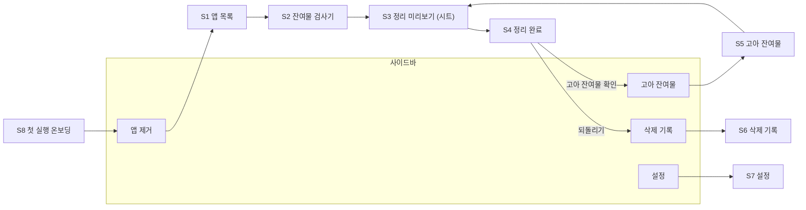

# macOS App Cleaner UI/UX 설계 (v1)

> 기준 문서: `docs/plan.md` v4
> 화면 목업: [App Cleaner UI/UX 캔버스](https://claude.ai/artifact/KAbV2S2rwNeNZw5nW6syiQ) — 아래 화면 번호(S1~S9)는 캔버스의 화면 번호와 같다. S10(Sentinel)은 캔버스 이후 추가한 화면이다.

---

## 1. 설계 원칙

| 원칙 | 화면에서의 구현 |
|---|---|
| **검사와 삭제를 분리한다** | 앱을 고르거나 놓으면 검사만 한다. 실제 이동은 항상 미리보기 시트(S3)를 거친다. 미리보기는 끌 수 없다. |
| **기본값이 안전하다** | 낮음 · 공유 · 사용자 데이터는 기본 선택하지 않는다. 고아 스캔은 보통도 기본 해제. 보호 항목은 선택 자체가 불가. |
| **왜 그렇게 판단했는지 보여준다** | 모든 항목에 판정 근거·정보원을 표시하고, 남겨두는 항목은 이유를 글로 쓴다 ("Excel이 함께 사용 중"). |
| **모든 정리는 되돌릴 수 있다** | 완료 화면과 삭제 기록에서 되돌리기. 빨간 위험 버튼은 쓰지 않고, 영구 삭제(보류 폴더 비우기)만 추가 확인. |
| **색만으로 구분하지 않는다** | 배지는 항상 글자를 포함한다 (높음/보통/낮음, 공유, 사용자 데이터 등). |
| **macOS다운 앱** | SwiftUI `NavigationSplitView`, 시스템 색·글꼴, 다크 모드, 키보드 탐색, VoiceOver 지원. |

---

## 2. 정보 구조



- 사이드바 항목: **앱 제거 / 고아 잔여물 / 삭제 기록** (위), **설정** (아래), 맨 아래 **권한 상태 카드**.
- 고아 잔여물 항목 옆 숫자 = 지난 스캔에서 찾은 그룹 수 (유지 목록 제외). 스캔 전에는 숫자 없음.
- 권한 상태 카드를 누르면 설정의 권한 섹션으로 이동.

### 2.1 진입 경로

| 진입 | 결과 |
|---|---|
| 앱 실행 (첫 실행) | S8 온보딩 → S1 |
| 앱 실행 (이후) | 마지막으로 보던 메뉴 |
| `.app`을 창 또는 Dock 아이콘에 드롭 | S2 (해당 앱 검사) |
| Finder에서 "다음으로 열기 › App Cleaner" | S2 |
| Sentinel 알림 "잔여물도 정리" · 메뉴의 최근 앱 (S10) | S2 (휴지통에 있는 앱 검사). 휴지통을 이미 비웠으면 S5 + 스캔 |
| Sentinel 정기 스캔 알림 "확인하기" · 메뉴 "고아 잔여물 스캔…" | S5 + 스캔 시작 |
| 메뉴 막대 *정리 › 고아 잔여물 스캔* (`⌘⇧O`) | S5 + 스캔 시작 |
| CLI | GUI와 같은 엔진·같은 기본 선택 규칙 (`plan.md` 7.3) |

---

## 3. 화면별 명세

### S1. 앱 제거 — 앱 목록
- **툴바**: 제목, 검색(이름·번들 ID, `⌘F`), 정렬(크기 / 이름 / 마지막 사용일).
- **드롭 영역**: 목록 위 고정. 드래그 중에는 창 전체가 드롭 대상으로 강조된다. "검사만 하고 아무것도 지우지 않습니다"를 명시.
- **출처 필터**: 전체 / App Store / Homebrew / 설치 패키지 / 직접 설치 (개수 표시).
- **목록 열**: 아이콘, 이름 + 버전 · 번들 ID, 출처, 크기, 마지막 사용.
  - 실행 중이면 "실행 중" 배지. 마지막 사용이 6개월 이상이면 강조색 글자.
  - 크기는 목록을 먼저 보여준 뒤 백그라운드로 계산해 채운다 (계산 중에는 "계산 중…").
- 하단: 앱 개수·총 크기, "Apple 기본 앱은 목록에 표시하지 않습니다".
- **동작**: 행 클릭 또는 `Return` → S2. 여러 앱 동시 제거는 MVP에서 지원하지 않는다.

### S2. 잔여물 검사기
- **헤더**: 뒤로(앱 목록), 아이콘, 이름, 버전 · 번들 ID · Team ID · 출처, 오른쪽에 **선택 크기/개수**와 찾은 전체.
- **상태 배너** (해당 시): 실행 중 / 같은 번들 ID의 다른 사본 존재 / 전체 디스크 접근 없음(일부 항목 누락 가능).
- **보기 필터**: 모두 / 선택됨 / 남겨둠, "낮은 신뢰도 항목 표시" 체크박스.
- **카테고리 목록** (접기/펼치기): 앱 본체, 샌드박스 컨테이너(하위 항목 펼침), 그룹 컨테이너, 백그라운드 서비스, 캐시·로그·저장된 상태, 환경설정, 시스템 폴더(관리자 권한), 낮은 신뢰도.
  - 카테고리 체크박스는 3상태(전체/일부/없음).
  - 항목 행 구성은 S9 "항목 행" 참조. 남겨두는 이유는 보조 설명 줄에 쓴다.
  - 보호 항목(iCloud 컨테이너 등)은 체크박스 없이 자물쇠 배지와 안내만.
- **오른쪽 정보 패널** (선택한 행): 전체 경로, 크기·파일 수·마지막 수정, 판정 근거, 정보원, 공유 시 사용 중인 앱과 지웠을 때의 영향, "Finder에서 보기".
- 목록 맨 아래: "로그인 항목 · 키체인은 정리 후 안내합니다".
- **하단 바**: 남겨두는 항목 요약(공유 n · 사용자 데이터 n · 낮음 n), 취소, **정리 미리보기 · n개, 크기** (선택 0개면 비활성).
- **사용자 데이터·공유 항목을 체크할 때**: 체크 즉시 정보 패널의 경고를 강조하고, S3에서 해당 항목을 별도 묶음으로 다시 보여준다 (추가 확인 대화상자는 띄우지 않는다).

### S3. 정리 미리보기 (시트)
- S2·S5 위에 뜨는 모달 시트. 이 시점까지 아무것도 바뀌지 않았다는 문구로 시작.
- **요약 3칸**: 옮길 항목, 확보 용량, 남겨둘 항목.
- **진행 순서** (`plan.md` 4.4와 동일한 순서): 서비스 중지 → 앱 종료 요청 → 환경설정 캐시 비우기 → 이동. 해당 없는 단계는 표시하지 않는다.
- **관리자 암호 안내**: 필요한 경우에만, 어떤 항목 때문인지 표시. 암호는 한 번만 묻는다.
- 사용자 데이터·공유 항목을 직접 선택했다면 별도 경고 묶음으로 표시.
- 접힌 "남겨두는 항목 n개 보기".
- 옵션: 개인정보 보호 권한 기록 초기화 (기본값은 설정을 따름).
- 버튼: **돌아가서 수정**, **휴지통으로 이동** (기본 버튼, `Return`). `Esc` = 돌아가기.
- CLI의 `--dry-run` 출력은 이 시트와 같은 정보를 JSON으로 낸다.

### 진행 중 (S3 → S4 사이)
- 시트 안에서 단계별 진행 표시 (현재 단계 강조, 완료 단계 체크).
- 앱이 종료 요청에 응답하지 않으면 시간 초과 후 "강제 종료 / 건너뛰기 / 취소" 선택.
- 실패한 항목이 있어도 나머지는 계속하고, 완료 화면에서 실패 목록과 이유를 보여준다.

### S4. 정리 완료
- 결과 요약: n개 · 크기를 휴지통(·보류 폴더)으로 옮김. 실패가 있으면 경고 묶음.
- 버튼: **되돌리기**, 휴지통 열기, **완료**(앱 목록으로).
- **직접 확인할 것**: 로그인 항목(시스템 설정 열기), 키체인(키체인 접근 열기, 검색어 안내), System Extension/커널 확장(해당 시), 남겨둔 항목 보기.
- 고아 잔여물 연결 카드 (지난 스캔 결과가 있으면 개수·크기 표시).

### S5. 고아 잔여물
- **툴바**: 제목, 마지막 스캔 정보(소요 시간, 확인한 설치 앱 수), **다시 스캔**.
- **스캔 전 상태**: 설명 + "스캔 시작" 버튼 + "아무것도 지우지 않습니다".
- **스캔 중**: 단계 표시(설치 앱 확인 → 후보 수집 → 판정), 결과는 찾는 대로 목록에 추가, 취소 가능.
- **Spotlight 색인 경고 배너**: 색인이 불완전할 때만. "낮음으로 낮췄다"는 결과 영향까지 설명.
- **필터**: 신뢰도(전체/높음/보통/낮음, 개수), 정렬(크기/신뢰도/마지막 수정일), **높음만 선택**.
- **그룹 행**: 체크박스(3상태), 펼치기, 점선 아이콘(앱이 없음을 표현), 추정 이름 + (삭제됨)/(추정), 항목 수 · 마지막 수정 · 번들 ID 또는 판정 메모, 신뢰도·공유 배지, 크기, **유지** 버튼.
- **항목 행**: 경로(고정폭), **근거:** 한 줄 (예: "실행 파일 …/ShipIt 이 없음"), 배지, 크기. 그룹당 처음 3개만 보이고 "n개 더 보기".
- **기본 선택**: 높음 + 사용자 데이터 아님. 보통·낮음은 사용자가 고른다.
- **유지**: 누르면 목록에서 사라지고 하단에 "되돌리기" 토스트. 설정 › 유지 목록에서 해제.
- **하단 바**: 선택 크기 · 그룹 수 · 항목 수 · 유지 목록 숨김 개수, **정리 미리보기** → S3.
- **결과 없음**: "정리할 잔여물이 없습니다" + 유지 목록에 숨긴 개수.

### S6. 삭제 기록
- **툴바**: 제목, 보류 폴더 사용량·가장 오래된 항목 경과일, Finder에서 보기.
- **왼쪽 작업 목록**: 대상, 시각 · 종류(앱 제거/고아 정리) · 개수 · 크기, 상태 배지(복원 가능 / 일부 복원 불가 / 되돌림 / 복원 불가).
  - 상태는 화면을 열 때 이동 위치의 존재를 확인해 갱신한다 (휴지통 비움 감지).
- **오른쪽 상세**: 시각·소요 시간·규칙 데이터 버전, 수행한 단계, 옮긴 항목 표(원래 위치 / 현재 위치 / 크기, 항목별 체크박스).
- 버튼: **모두 되돌리기**, 선택한 항목만 되돌리기, 기록 내보내기(JSON).
- 되돌릴 때 원래 위치에 같은 이름이 있으면 항목별로 "덮어쓰기 안 함(이름 변경해 복원) / 건너뛰기" 선택. 중지했던 서비스는 "다시 등록" 체크박스(기본 켬).
- 보류 기간이 지난 항목이 있으면 상단 배너로 영구 삭제 여부를 묻는다 (자동 삭제하지 않음).

### S7. 설정
| 섹션 | 항목 |
|---|---|
| 권한 | 전체 디스크 접근(상태, 시스템 설정 열기), 앱 관리(상태), 관리자 헬퍼(설치/제거 — Phase 3) |
| 정리 방식 | 보류 폴더 보관 기간(7/14/30/60일), 정리 전 미리보기(항상 켬, 비활성 표시), 개인정보 보호 권한 기록 초기화 기본값 |
| 고아 잔여물 스캔 | 고급: 숨김 설정 폴더 포함(`~/.ssh`·`~/.gnupg`는 항상 제외), 정기 스캔 알림(끔/매주/매달, 마지막 스캔 날짜) — S10 |
| 휴지통 감시 (Sentinel) | 휴지통 감시 켜기/끄기, Sentinel 상태(켜짐 / 승인 필요 / 꺼짐 / 사용할 수 없음), 휴지통 읽기·알림 허용 상태와 해당 시스템 설정 열기 — S10 |
| 유지 목록 | 그룹/항목, 유지한 날짜, 해제 |
| 규칙 데이터 | 버전, 갱신 시각, 서명 확인 상태, 지금 확인, 자동 갱신 |

### S8. 첫 실행 — 권한 온보딩
- 앱이 하는 일 한 문장 + 안전 약속 3가지(휴지통·되돌리기 / 항상 미리보기 / 공유·사용자 데이터 기본 보존).
- 필요한 권한: **전체 디스크 접근(권장)** — 설정 경로 안내와 "시스템 설정 열기", 돌아오면 자동 재확인(앱 활성화 시 상태 확인). 앱 관리·관리자 암호는 "필요할 때 요청"으로만 안내.
- 버튼: 나중에 하기 / 계속. 권한 없이도 사용 가능하며, 이때 S2·S5에 "일부 항목을 찾지 못했을 수 있음" 배너를 띄운다.

### S9. 컴포넌트 · 배지 체계
캔버스 S9 참조. 배지 3계열(신뢰도 / 데이터 성격 / 공유·상태), 기본 선택 규칙 표, 항목 행 구조, 버튼·알림 종류, 색·글자 크기.

### S10. Sentinel — 휴지통 감시 · 정기 스캔 알림 (메뉴 막대)
`plan.md` 7.3 '2차' 기능. 결정 #4에 따라 착수 시점(2026-10-15)에 설계했다.

**구성**
- 별도 프로세스 `App Cleaner Sentinel.app` — 본 앱 번들 `Contents/Library/LoginItems/` 안에 있고 `SMAppService.loginItem`으로 로그인 항목에 등록한다.
  Dock 아이콘·창 없음(`LSUIElement`), SwiftUI 없이 AppKit `NSStatusItem` 메뉴 하나만 둔다 (상주 메모리를 작게).
- **실행 조건**: S7에서 "휴지통 감시" 또는 "정기 스캔 알림"이 하나라도 켜져 있으면 등록, 둘 다 끄면 등록 해제(실행 중이면 종료).
- Sentinel은 **아무것도 지우거나 옮기지 않는다.** 알리고, 누르면 본 앱의 검사 화면(S2·S5)을 연다. 정리는 언제나 S3 미리보기를 거친다.

**메뉴 막대 아이콘**: SF Symbol `trash.circle` (템플릿 이미지 — 밝기·다크 모드 자동). 누르면 아래 메뉴.

```
App Cleaner Sentinel
─────────────────────────────
휴지통 감시 중                              ← 상태 (비활성 항목)
  · 휴지통 감시 꺼짐
  · 휴지통을 읽을 수 없음 — 전체 디스크 접근 필요…   ← 누르면 시스템 설정
정기 스캔: 매달 · 다음 11월 14일              ← 상태 (비활성 항목)
  · 정기 스캔 꺼짐
알림이 꺼져 있음 — 알림 설정 열기…            ← 알림을 거부했을 때만
─────────────────────────────
최근 휴지통으로 간 앱                          ← 이번 실행 중 감지한 앱, 최대 5개 (없으면 섹션 숨김)
   Slack 잔여물 정리…                         ← S2
─────────────────────────────
고아 잔여물 스캔…                             ← S5 + 스캔
App Cleaner 열기
설정…                                         ← S7
─────────────────────────────
Sentinel 종료                                 ← 다음 로그인 때 다시 실행. 완전히 끄려면 S7
```

**알림** (`UNUserNotificationCenter`)

| 종류 | 제목 | 본문 | 동작 버튼 | 누르면 (본문·버튼 같음) |
|---|---|---|---|---|
| 휴지통 유입 | "Slack을 휴지통으로 옮겼습니다" | "설정·캐시 같은 잔여물이 남아 있을 수 있습니다. 검사만 하고 아무것도 지우지 않습니다." | **잔여물도 정리** | S2 — 휴지통 안의 앱을 검사. 앱 본체는 이미 휴지통에 있으므로 목록에서 빼고 "이미 휴지통에 있음" 배너 |
| 정기 스캔 | "정리할 수 있는 잔여물이 있습니다" | "삭제된 앱 3개의 잔여물 1.2 GB를 찾았습니다 (신뢰도 높음)." | **확인하기** | S5 + 스캔 (결과는 본 앱에서 다시 스캔해 보여 준다) |

- 휴지통 유입 판단: `~/.Trash` 바로 아래에 **새로 생긴 `.app`** 만. 같은 항목(볼륨·inode 기준)을 휴지통 안에서 이름만 바꾸거나 이벤트가 중복되면 다시 알리지 않는다.
  폴더째 버린 앱, 외장 볼륨 휴지통(`/Volumes/*/.Trashes`)은 대상이 아니다.
- 알리지 않는 경우: Apple 앱(`com.apple.*`), App Cleaner 자신(`com.dallisoft.AppCleaner*`), 번들 ID가 없는 번들,
  **App Cleaner가 방금 직접 제거한 앱**(GUI·CLI의 앱 제거가 시작될 때 엔진이 보내는 신호로 10분간 무시).
- 앱 식별 정보(번들 ID·이름)는 휴지통 안의 `Info.plist`에서 읽는다. 알림을 누르기 전에 휴지통을 비웠으면 앱 검사를 할 수 없으므로 S5로 연다 (남은 파일은 이제 고아 잔여물이다).
- 정기 스캔 알림: 유지 목록을 뺀 뒤 **신뢰도 높음 항목이 1개 이상**일 때만. 높음이 없으면 조용히 끝난다. 자동 정리는 하지 않는다.
- 알림 허용: Sentinel이 처음 실행될 때(기능이 하나라도 켜져 있을 때) macOS가 묻는다. 거부하면 메뉴와 S7에 "알림이 꺼져 있음"과 알림 설정 열기 버튼을 보여 준다.

**S7 설정**
- *고아 잔여물 스캔* 섹션: **정기 스캔 알림** 끔 / 매주 / 매달 (기본 끔). 보조 설명 줄에 "마지막 스캔: 10월 15일" (없으면 "아직 스캔하지 않음").
- *휴지통 감시 (Sentinel)* 섹션
  - **휴지통 감시** 토글 (기본 끔) — "앱을 휴지통으로 옮기면 남은 잔여물도 정리할지 알려 줍니다."
  - **Sentinel 상태** 배지(로그인 항목 등록 상태): 켜짐 / 승인 필요(로그인 항목 설정 열기) / 꺼짐 / 사용할 수 없음(`.app` 번들 밖에서 실행한 개발 빌드) + 등록 실패 시 오류 문장.
  - **휴지통 읽기**: Sentinel이 `~/.Trash`를 읽지 못하면 "Sentinel에 전체 디스크 접근 필요" + 시스템 설정 열기.
  - **알림**: 거부했으면 "알림이 꺼져 있음" + 알림 설정 열기.

**본 앱으로 넘기기**: URL 스킴 `com.dallisoft.appcleaner://` — `inspect?path=<휴지통의 .app 경로>`, `orphans`, `settings`.
Sentinel은 자신을 포함한 `App Cleaner.app`을 지정해(`NSWorkspace.open(_:withApplicationAt:)`) 열므로, 개발 빌드 등 다른 사본이 대신 열리지 않는다.
본 앱이 실행 중이든 아니든 같은 경로(`application(_:open:)`)로 받는다. 링크는 검사 화면만 열고 아무것도 바꾸지 않는다.

**백그라운드 실행 방식 (결정)**

| 방식 | 장점 | 단점 |
|---|---|---|
| **Sentinel 내부 스케줄러 (채택)** | 휴지통 감시 때문에 어차피 상주 → 등록·승인 항목 하나, 설정 변경을 바로 반영, 다음 예정일을 메뉴에 표시 | 정기 스캔만 켜도 Sentinel이 상주 |
| LaunchAgent (`SMAppService.agent`, `StartCalendarInterval`) | 스캔할 때만 실행 | 로그인 항목이 둘(승인도 둘), "마지막 실행 + 주기"가 아니라 달력 시각 기준, 잠자기 중 놓친 실행·설정 반영을 따로 처리 |

- `NSBackgroundActivityScheduler`로 1시간마다(시스템이 전력 상황에 맞춰 조정) "마지막 성공 + 주기"가 지났는지 확인한다. 실패하면 6시간 뒤 다시 시도.
- 스캔은 상주 프로세스 안이 아니라 번들의 CLI(`Contents/Helpers/appcleaner orphans --min-confidence high --json`)를 **자식 프로세스로** 실행한다.
  스캔에 쓴 메모리는 자식이 끝나면 돌려받으므로 Sentinel의 상주 메모리가 늘지 않는다. 엔진이 같으므로 인벤토리 캐시(`inventory-cache.json`의 서명 캐시)·유지 목록을 앱과 그대로 공유한다.
- 설정은 본 앱의 `UserDefaults`(`com.dallisoft.AppCleaner`)에 두고 Sentinel이 읽는다. Sentinel은 상태 값(마지막 스캔, 휴지통 읽기 가능, 알림 허용)만 쓴다.
  본 앱이 설정을 바꾸면 분산 알림으로 Sentinel에 다시 읽으라고 알린다.

---

## 4. 공통 상호작용

### 4.1 키보드
| 키 | 동작 |
|---|---|
| `⌘1` `⌘2` `⌘3` | 앱 제거 / 고아 잔여물 / 삭제 기록 |
| `⌘,` | 설정 |
| `⌘F` | 검색 |
| `⌘⇧O` | 고아 잔여물 스캔 |
| `↑` `↓` / `←` `→` | 행 이동 / 카테고리·그룹 접기·펼치기 |
| `Space` | 현재 행 선택 토글 |
| `⌘R` | Finder에서 보기 |
| `⌘⌫` | 정리 미리보기 열기 (바로 삭제하지 않음) |
| `⌘Z` | 직전 정리 되돌리기 (완료 화면·삭제 기록) |
| `Esc` | 시트 닫기 / 뒤로 |

### 4.2 공통 상태
| 상태 | 표현 |
|---|---|
| 크기 계산 중 | 크기 칸에 "계산 중…", 합계는 "약" 표시 후 갱신 |
| 권한 부족으로 읽지 못한 위치 | 배너 + 해당 카테고리에 "확인하지 못함" 행 |
| 관리자 권한 거부 | 해당 항목만 실패로 표시, 나머지 결과는 유지 |
| 앱 관리 권한 거부 | 앱 본체만 실패, 시스템 설정 열기 버튼이 있는 안내 |
| 스캔·정리 오류 | 항목 단위 실패 목록 + 이유. 전체 작업을 롤백하지 않음 (기록에 남은 것은 되돌리기 가능) |

### 4.3 문구 원칙
- 결과와 영향 중심으로 쓴다: "삭제" 대신 "휴지통으로 이동", "공유 리소스" 대신 "Excel이 함께 사용 중".
- 내부 용어(TCC, cfprefsd, bootout, entitlements)는 정보 패널의 "정보원" 칸에만 쓴다.
- 신뢰도는 높음/보통/낮음, 데이터 성격은 재생성 가능/설정/사용자 데이터/보호됨으로 통일.
- UI 언어: 한국어·영어 동시 지원 (String Catalog).

### 4.4 접근성
- 모든 배지·상태는 글자 포함, VoiceOver 레이블에 신뢰도·데이터 성격·공유 정보를 함께 읽는다 (예: "UBF8T346G9.Office, 3.1 기가바이트, 신뢰도 높음, 공유: Excel 외 2개 앱 사용 중, 선택 안 됨").
- 3상태 체크박스는 "일부 선택됨"을 읽는다.
- 대비 4.5:1 이상, 다크 모드·고대비 모드·동작 줄이기 대응.

---

## 5. 결정 사항 (2026-10-14 확정)

| # | 항목 | 결정 |
|---|---|---|
| 1 | 여러 앱 동시 제거 | **MVP 제외.** 이후 필요 시 S1 다중 선택 + S3 앱별 묶음 표시로 확장 |
| 2 | 보통(Medium) 기본 선택 (앱 제거) | **선택 + 강조 표시** (`plan.md` 4.3.1 그대로). 고아 스캔은 기본 해제 유지 |
| 3 | 사용자 데이터를 직접 선택할 때 | **추가 대화상자 없음.** S2 정보 패널 경고 강조 + S3 별도 경고 묶음으로 처리 |
| 4 | 메뉴바 상주(Sentinel)·Finder 확장 화면 | **이번 설계 범위 제외.** 2·3차 기능 착수 시 별도 설계 → Sentinel은 S10에 설계 (2026-10-15). Finder 확장은 3차 |
| 5 | 앱 아이콘·이름 | **자리표시자 유지.** 개발 착수를 막지 않으며, 배포(Phase 4) 전까지 별도 결정 |
